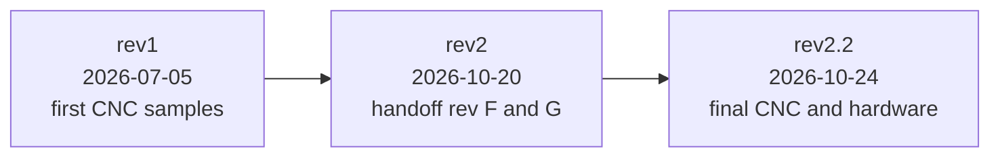

# OpenFrame-5F changelog

Each revision is a named version in the Onshape document OpenDrone-V2,
workspace 5", exported once to `releases/<rev>/` (STEP per part, drawing PDF,
`manifest.json` with SHA-256 per file). Onshape is the source for geometry and
for every count below unless a row says otherwise.

| Rev | Onshape version | Microversion | State of | Used for |
|---|---|---|---|---|
| rev1 | `OpenFrame-5F rev1` | `cf22b54cac77cb39826ba49c` | 2026-07-05 17:21 UTC | the first CNC sample frames, cut from these files |
| rev2 | `OpenFrame-5F rev2` | `37189c0adbdf9f2badcc886d` | 2026-10-20 | quoted for the first production frame batch, not ordered on 2026-10-24 (handoff packages rev F and rev G, the 5" parts are the same in both) |
| rev2.2 | `fixed and standardised` (branch `5in-fixes`) | `87dee3a021abd49e11b659d6` | 2026-10-24 10:54 UTC | final CNC carbon, CNC aluminium and bought hardware. [`releases/rev2.2/`](releases/rev2.2) |

rev1 is the only revision produced so far. rev2.x is the next production: rev2 (handoff packages rev F and G) and rev2.2, the final CNC parts and hardware. There is no 5" rev2.1: the numbers follow the 3", so a frame set has one revision.

## rev2.2

The final state of every CNC carbon part, both CNC aluminium camera side
plates and the bought hardware (founder, 2026-10-24). The printed TPU parts
are preliminary: they fit the DJI O4 Pro only and will change for more video
systems. Shipped TPU colours are black and PCB green, as in the CAD. The aluminium
camera side plates are anodised Pantone 7549 C (gold).

Made by the founder as version `fixed and standardised` of the Onshape branch
`5in-fixes` (from rev2). Geometry compared with rev2 / handoff packages rev F
and G (STEP, 2026-10-24): cross and bottom plate unchanged.

| Change from rev2 | Detail |
|---|---|
| Top plate | holes added for future GPS mounts (one field of about 15 x 8 mm) |
| Arm | motor centre bore Ø6.0 becomes Ø7.0 (founder) |
| Middle plate | the one Ø4.6 M3 insert hole becomes Ø4.5 like the other six |
| Camera side plates (Standoff-L/R) | M3 tap drill Ø2.6 becomes Ø2.5 (the spec value) |
| Arm screws | ISO 7380-1 M4x12: the tip ends flush with the top of the 2.4 mm insert and 2.4 mm under the ESC. An M4x14 would end 0.37 mm under the ESC board |
| Stack | ISO 4762 M3x20 with an ISO 10511 thin nylon lock nut on top (was a button head M3x22 into the inserts). Uncompressed, the M3x20 tip ends 0.9 mm below the top of the nut; the rubber grommets compress when the stack is tightened, so the length stays (founder) |
| M3x6 for most screws | standoff ends, camera side plates and AirTag mount: 3.0 to 3.5 mm of thread (founder, after building a 5" rev1). The doubled M3x6 + M3x8 in 6 holes are gone |
| Bumper | the two rear bottom side plate holes take an M3x6 without the bumper and an M3x8 with it; both are modelled and both ship |
| Imported screws | the `Volumenkörper1` STEP bodies replaced by Onshape standard content |
| Screw finish | every frame screw steel class 12.9, black. Nylon patch on the arm, centre, camera side plate and standoff screws; none on the stack screws or on screws with TPU under the head |
| Parts | `18mmx4mm` renamed `Standoff M3 F-F 20 OD5` (bought, 7075); `softmount m2` renamed `Grommet M3`; Part Studio `Insert M3 (provisional)` added |

Open after rev2.2:

| Item | State |
|---|---|
| Model | one `Bumper` instance has no source part. `Cam-Mount-R` was placed in the assembly after the version; its STEP is in `releases/rev2.2/` |
| Counterbore for M3 button heads | Ø5.8 on the drawing, Ø6.0 proposed (an ISO 7380 M3 head is up to 5.7 mm) |
| Drawing in Onshape | title block reads "OpenDrone Frame 3""; gives H8 holes; rev G gives +0.03/0 and the insert notes |
| Insert | supplier insert type and part number open |
| Grommet M3 | size and hardness open |

## rev2

| Change from rev1 | Detail |
|---|---|
| Carbon and aluminium parts | Every carbon and aluminium part changed geometry. The cross grows from 28.8 to 37.3 mm wide; the side plates (Standoff-L/R) from 23.5 to 25.5 mm. rev1 and rev2 parts do not mix in one frame. |
| Arm screws | M4: 4x M4x12 into 4 M4 inserts in the middle plate |
| Centre screw | 1x M3x12 through the cross |
| Threaded inserts, middle plate | 10x M3 become 7x M3 + 4x M4, flush |
| Other screws | M3x10, M3x20, M2.5x6 and M2x20 are gone; M3x6, M3x8 and M3x22 are new |
| Printed parts | anti-slip pad, Airtag/antenna mount and Cam-Mount-L added; boots are 2x Boot-L + 2x Boot-R |
| Hardware in CAD | rev1 had no screws in the assembly; rev2 has them |

Hardware per set, rev2, from the Onshape assembly. This is the rev2 list; [`hardware.csv`](hardware.csv) follows rev2.2.

| Item | Standard | Qty |
|---|---|---|
| Button head screw M3x6 | ISO 7380 | 18 |
| Button head screw M3x8 | ISO 7380 | 6 |
| Button head screw M3x12 | ISO 7380 | 1 |
| Button head screw M3x22 | ISO 7380 | 4 |
| Button head screw M4x12 | ISO 7380 | 4 |
| Threaded insert M3, middle plate | | 7 |
| Threaded insert M4, middle plate | | 4 |
| Soft-mount grommet | | 8 |
| Standoff, aluminium, 20 mm, OD 5 (part `18mmx4mm`) | | 4 |

Open in the model, rev2:

| Item | State |
|---|---|
| `Bumper` | instanced in the assembly without a source part |
| `Cam-Mount-R` | in the Part Studio, not in the assembly |
| Drawing | title block reads "OpenDrone Frame 3""; bolt holes given as H8 (3.000-3.010 mm, 4.000-4.010 mm) |
| Part names | `18mmx4mm` is 20 x 5 mm; `Standoff-L/R` are the aluminium camera side plates; `Base-Top` is the middle plate; the three `Volumenkörper1` bodies are ISO 7380 screws |

## rev1

The state the first CNC samples were cut from. The carbon and aluminium STEP
files in `releases/rev1/step/` have the same geometry as the files sent for
manufacture on 2026-07-05 (point-for-point comparison, 7 of 7 parts).

Screws were not in the CAD yet. The rev1 hardware list below is the design list
the frame was drawn around (2026-07-01), not an Onshape count. The press-nut
count is from the rev1 assembly.

| Item | Standard | Qty |
|---|---|---|
| Button head screw M3x10 | ISO 7380 | 10 |
| Button head screw M3x12 | ISO 7380 | 4 |
| Button head screw M3x20 | ISO 7380 | 4 |
| Button head screw M2.5x6 | ISO 7380 | 8 |
| Button head screw M2x20 | ISO 7380 | 4 |
| Countersunk screw M2x5 (air unit) | ISO 10642 | 4 |
| Press nut M3 | | 10 |
| Standoff M3, 20 mm, OD 4.6 | | 4 |
