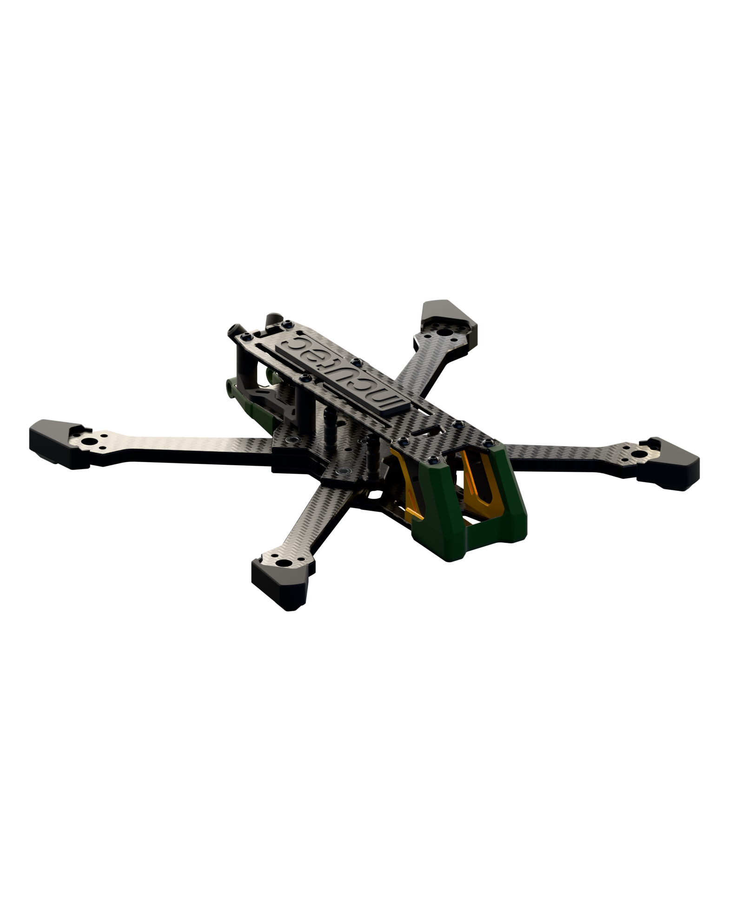
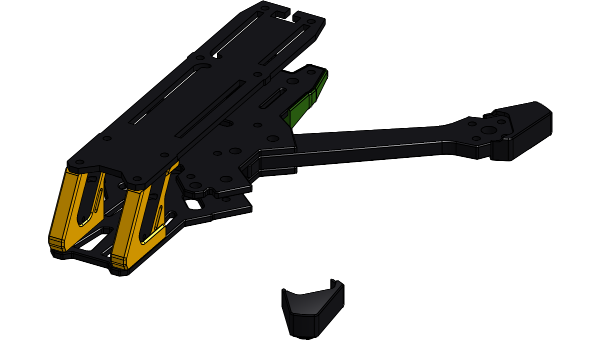

# OpenFrame-5F

The 5" OpenFrame: a CNC carbon fibre freestyle FPV frame in the
incutec OpenDrone line. The 3" and 5" frames are separate repositories:
[OpenFrame-3F](https://github.com/OpenDrone-hw/OpenFrame-3F) and
[OpenFrame-5F](https://github.com/OpenDrone-hw/OpenFrame-5F).

## Where the design lives

| | |
|---|---|
| Source | [Onshape document OpenDrone-V2, workspace 5"](https://cad.onshape.com/documents/78e093d02798373a79bc68d0/w/c0ca752de47c1227bb727503) |
| Link file | [`cad/onshape.json`](cad/onshape.json): document, workspace, element and part ids |
| Released exports | `releases/<rev>/`, exported from a named Onshape version and never edited. No revision has been released yet. |
| Parts per set | [`parts.csv`](parts.csv) |
| Fasteners and hardware | [`hardware.csv`](hardware.csv) |
| Standard | Incutec mechanical repository template |

## A set

14 part types, 22 pieces, 8 of them carbon. Taken from the
Onshape assembly (snapshot of 2026-10-09). Materials are as set in the Onshape model and blank where
the model sets none; the process column is not from the model. Carbon plate and side plate (Standoff-L/R)
thicknesses are measured values.
VTX-Mount and anti-slip pad are taken from document versions `V4` and
`antislip pad v2` (`sourceVersion` in `cad/onshape.json`). A version cannot
be edited, so the model still gives VTX-Mount as PLA and the pad no material.
`Bumper` is in the assembly without a source part and not in `parts.csv`; `Cam-Mount-R` is in the
`frame` Part Studio but not in the assembly. The model check lists both.

| Part | Qty | Material | Thickness | Made by |
|---|---|---|---|---|
| 18mmx4mm | 4 | Aluminum |  | CNC aluminium |
| Airtag/Antenna mount | 1 |  |  | 3D print, TPU |
| anti-slip pad | 1 |  |  | moulded silicone |
| Arm | 4 | Carbon fiber epoxy (61%) | 6 mm | CNC carbon plate |
| Base-Bot | 1 | Carbon fiber epoxy (61%) | 3 mm | CNC carbon plate |
| Base-Top | 1 | Carbon fiber epoxy (61%) | 3 mm | CNC carbon plate |
| Boot-L | 2 |  |  | 3D print, TPU |
| Boot-R | 2 |  |  | 3D print, TPU |
| Cam-Mount-L | 1 |  |  | 3D print, TPU |
| Cross | 1 | Carbon fiber epoxy (61%) | 6 mm | CNC carbon plate |
| Standoff-L | 1 | Aluminum | 7 mm | CNC aluminium |
| Standoff-R | 1 | Aluminum | 7 mm | CNC aluminium |
| Top | 1 | Carbon fiber epoxy (61%) | 2.5 mm | CNC carbon plate |
| VTX-Mount | 1 | PLA |  | 3D print, TPU |

Fasteners and hardware per set, from the same assembly:

| Item | Qty |
|---|---|
| m3 pressnut | 7 |
| m4 pressnut | 4 |
| Socket button head screw M3x0.5 x 22 | 4 |
| Socket button head screw M3x0.5 x 6 | 18 |
| softmount m2 | 8 |
| Volumenkörper1 | 11 |

`m3 pressnut` and `m4 pressnut` are counted from the Onshape assembly. The three
`Volumenkörper1` bodies are STEP imports of ISO 7380 screws (M3x12 x1, the centre bolt;
M3x8 x6; M4x12 x4); `hardware.csv` lists them as one row with the split in `size`. The four M5 prop nuts belong to the motors and are left out of
`hardware.csv`; `cad/onshape.json` lists them under `modelCheck.ignoreHardware`.

## Model checks

Result of the Incutec Onshape model check, run offline on 2026-10-09 against the
snapshot of workspace 5" in the Onshape document. A row stays until the model is fixed.

| Check | Finding |
|---|---|
| Missing parts | `Bumper <1>` has no source part (deleted or not shared) |
| Unused parts | `Cam-Mount-R` is in the `frame` Part Studio but not in the assembly |
| Materials | `anti-slip pad`, `Boot-L`, `Boot-R`, `Bumper`, `Airtag/Antenna mount` and `Cam-Mount-L` have no material set in the model |
| Parts list | `Bumper`: assembly 1, not in parts.csv |

## Key dimensions

| | 5" |
|---|---|
| Top plate | 2.5 mm |
| Middle plate | 3.0 mm |
| Bottom plate | 3.0 mm |
| Cross | 6.0 mm |
| Arm | 6.0 mm |
| Side plates (Standoff-L/R) | 7.0 mm |
| Bolt holes | Ø3.1 (M3) |
| Press-nut holes | Ø4.5 (M3) |
| Bolt-head counterbore | Ø5.8 (M3 ISO 7380) |
| Countersink | none |
| Camera mount thread | M3 |

Chamfers 0.5 mm 45°, outer fillets R1.0 mm, inner fillets R1.05 mm unless the
released drawing says otherwise. The cross-to-arm interface is a press fit and is the
tightest tolerance in the design. These are design values: no drawings have been
released from this repository yet.

## Licence

Hardware licensed under [CERN-OHL-S-2.0](https://ohwr.org/cern_ohl_s_v2.txt),
see [LICENSE](LICENSE). Contributing: [CONTRIBUTING.md](CONTRIBUTING.md).
