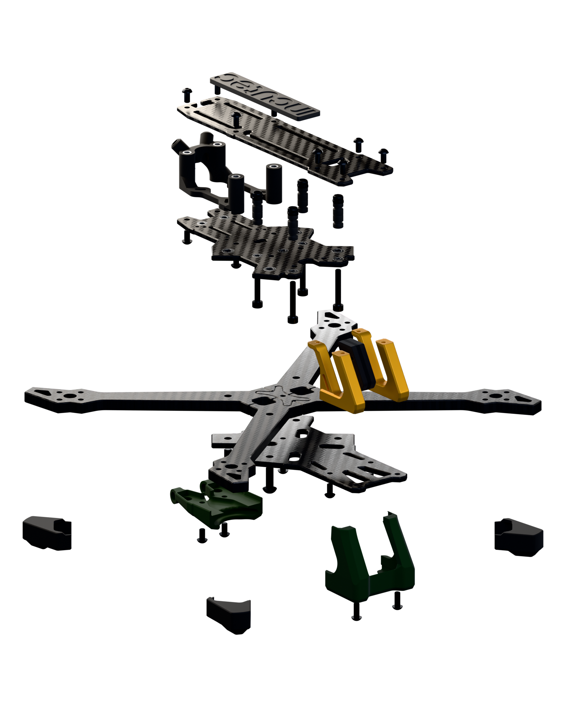
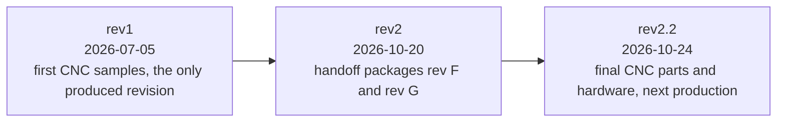
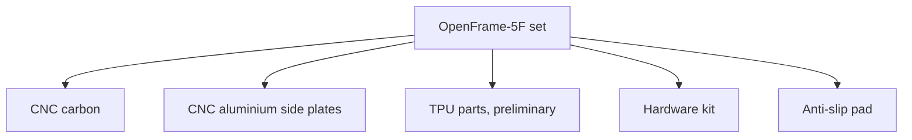

# OpenFrame-5F

The 5" OpenFrame: a CNC carbon fibre freestyle FPV frame in the
incutec OpenDrone line. The 3" and 5" frames are separate repositories:
[OpenFrame-3F](https://github.com/OpenDrone-hw/OpenFrame-3F) and
[OpenFrame-5F](https://github.com/OpenDrone-hw/OpenFrame-5F).

The CNC carbon parts, the CNC aluminium camera side plates and the bought
hardware are final in rev2.2. The printed TPU parts are preliminary: they
fit the DJI O4 Pro only and will change to fit more video systems. They are
printed by Incutec in black and PCB green. The aluminium camera side plates
are anodised Pantone 7549 C (gold).

## At a glance

| | |
|---|---|
| Wheelbase | 226 mm |
| Props | 5" |
| Top / middle / bottom plate | 2.5 / 3.0 / 3.0 mm carbon |
| Arms, cross | 6 mm carbon |
| Camera side plates | 7 mm CNC aluminium |
| Stack mount | 30.5 x 30.5 M3 (inserts) |
| Motor mount | 16 x 16, M3 |
| Standoffs | 20 mm, M3 female-female, OD 5 |

## Revisions

| Rev | Date | Used for | Files |
|---|---|---|---|
| rev1 | 2026-07-05 | first CNC samples, the only produced revision | [`releases/rev1`](releases/rev1) |
| rev2 | 2026-10-20 | handoff packages rev F and rev G | [`releases/rev2`](releases/rev2) |
| rev2.2 | 2026-10-24 | final CNC parts and hardware, next production | [`releases/rev2.2`](releases/rev2.2) |

Every revision is a named version in the Onshape document OpenDrone-V2, exported
once to `releases/<rev>/` (STEP per part, drawing PDF, `manifest.json` with
SHA-256 per file) and never edited. rev2.2 is the Onshape version
`fixed and standardised` of the branch `5in-fixes`. Changes per revision:
[`CHANGELOG.md`](CHANGELOG.md).

| | |
|---|---|
| Source | [Onshape document OpenDrone-V2](https://cad.onshape.com/documents/78e093d02798373a79bc68d0/w/c0ca752de47c1227bb727503) |
| Link file | [`cad/onshape.json`](cad/onshape.json): document, workspace, element and part ids |
| Bill of materials | [`bom.csv`](bom.csv): every part and every piece of hardware in a set, counted from the assembly |
| Standard | Incutec mechanical repository template |

## What is in a set

From [`bom.csv`](bom.csv) (rev2.2). Materials are as set in the Onshape
model and blank where the model sets none (printed parts are marked PLA in the
model and printed in TPU); the process column is not from the model.

**CNC carbon**

| Part | Type | Qty | Thickness |
|---|---|---|---|
| Arm | arm | 4 | 6 mm |
| Base-Bot | plate | 1 | 3 mm |
| Base-Top | plate | 1 | 3 mm |
| Cross | cross | 1 | 6 mm |
| Top | plate | 1 | 2.5 mm |

**CNC aluminium**

| Part | Type | Qty | Thickness |
|---|---|---|---|
| Standoff-L | camera side plate | 1 | 7 mm |
| Standoff-R | camera side plate | 1 | 7 mm |

**Bought**

| Part | Type | Qty | Thickness |
|---|---|---|---|
| Standoff M3 F-F 20 OD5 | standoff | 4 |  |

**Moulded**

| Part | Type | Qty | Thickness |
|---|---|---|---|
| anti-slip pad | pad | 1 |  |

**3D printed TPU (preliminary)**

| Part | Type | Qty | Thickness |
|---|---|---|---|
| Airtag/Antenna mount | mount | 1 |  |
| Boot-L | arm boot | 2 |  |
| Boot-R | arm boot | 2 |  |
| Bumper | bumper | 1 |  |
| Cam-Mount-L | camera soft mount | 1 |  |
| Cam-Mount-R | camera soft mount | 1 |  |
| VTX-Mount | air unit mount | 1 |  |

Threaded inserts (7 x M3 + 4 x M4) are pressed into the middle plate by the
carbon supplier.

## Hardware kit

One bag per frame: every screw and nut kind of the frame plus 2 spares
(41 screws in 6 kinds). Every screw is black-oxide alloy steel, class 12.9.
The bumper holes get an M3x6 without the bumper and an M3x8 with it; both ship.

| IPN | Item | Nylon patch | In the frame | In the kit | Where |
|---|---|---|---|---|---|
| `FAS-M4X12-BH-NP` | ISO 7380-1 M4x12 | yes | 4 | 6 | arms |
| `FAS-M3X12-BH-NP` | ISO 7380-1 M3x12 | yes | 1 | 3 | centre through the cross |
| `FAS-M3X6-BH-NP` | ISO 7380-1 M3x6 | yes | 16 | 18 | camera side plates, standoff ends |
| `FAS-M3X6-BH` | ISO 7380-1 M3x6 | no | 2 | 4 | AirTag/antenna mount |
| `FAS-M3X8-BH` | ISO 7380-1 M3x8 | no | 2 | 4 | bumper option |
| `FAS-M3X20-SHCS` | ISO 4762 M3x20 | no | 4 | 6 | stack |
| `FAS-NUT-M3-NYL` | ISO 10511 thin nylon lock nut M3 |  | 4 | 6 | stack |
| `GRM-M3-SIL50` | silicone grommet M3 |  | 8 | 8 | stack |
| `FRM-SO-5-20` | standoff M3 F-F 20 mm OD 5, aluminium |  | 4 | 4 |  |

Motor screws (16 x M3x8) and the M5 prop nuts ship with the motors and props and are not frame hardware.

Hardware per set as counted in the Onshape assembly ([`bom.csv`](bom.csv), kind `hardware`):

| Item | Standard | Size | Qty |
|---|---|---|---|
| Socket button head screw M4x0.7 x 12 | ISO 7380-1 | M4x12 | 4 |
| Socket button head screw M3x0.5 x 12 | ISO 7380-1 | M3x12 | 1 |
| Socket button head screw M3x0.5 x 6 | ISO 7380-1 | M3x6 | 18 |
| Socket button head screw M3x0.5 x 8 | ISO 7380-1 | M3x8 | 18 |
| Hex socket head cap screw M3x0.50 x 20 | ISO 4762 | M3x20 | 4 |
| Prevailing torque nut thin M3x0.50 | ISO 10511 | M3 | 4 |
| m3 pressnut |  | M3 | 7 |
| m4 pressnut |  | M4 | 4 |
| Grommet M3 |  | M3 | 8 |

## Checks on rev2.2

Run on the STEP export of rev2.2 on 2026-10-24: thread engagement and clearance
for every screw, and a geometry comparison of every CNC part with the previous
revision (see [`CHANGELOG.md`](CHANGELOG.md)).

| Check | Result |
|---|---|
| Screws into inserts | arm M4x12 and centre M3x12 end flush with the 2.4 mm inserts; the ESC is 2.4 mm above the arm screws |
| Side plate screws | 3.0 to 3.5 mm of thread |
| Stack | M3x20 with a thin nylon lock nut: 3.0 mm in the nut before the grommets are compressed; the grommets compress when tightened, so the tip reaches through the nylon ring |
| Duplicates | none (the bumper M3x6 / M3x8 pair is the deliberate option) |
| Model | one `Bumper` instance has no source part; `Cam-Mount-R` was placed in the assembly after the version (its STEP is in the release) |

## Key dimensions

From the drawing in Onshape and the rev G frame parts specification.

| | |
|---|---|
| M3 bolt holes | Ø3; the Onshape drawing says H8 (3.000-3.010), the rev G spec says +0.03/0 (3.00-3.03) |
| M4 bolt holes, bottom plate | Ø4; the Onshape drawing says H8 (4.000-4.010), the rev G spec says +0.03/0 (4.00-4.03) |
| Insert holes, middle plate | Ø4.5 (M3), M4 reference only: sized to the insert used |
| Side plate tap drill | Ø2.5 (M3) |
| Bolt-head counterbore | Ø5.8 (M3 ISO 7380; Ø6.0 proposed) |

Chamfers 0.5 mm 45°, outer fillets R1.0 mm, inner fillets R1.05 mm unless the
drawing says otherwise. The cross-to-arm fit is the tightest tolerance in the design:
0.000-0.100 mm between both parts on the drawing.

## Licence

Hardware licensed under [CERN-OHL-S-2.0](https://ohwr.org/cern_ohl_s_v2.txt),
see [LICENSE](LICENSE). Contributing: [CONTRIBUTING.md](CONTRIBUTING.md).
